<div align="center">

<picture>
  <source media="(prefers-color-scheme: dark)" srcset=".github/assets/banner-dark.svg">
  
</picture>

**Optional catalogs, translation and formatting for PAM Native, in pure PHP.**<br>
No native dependencies, permissions, timers, polling or network requests.

[](https://packagist.org/packages/pushinbr/pam-native-i18n)
[](https://github.com/push-in/pam-native-i18n/releases/latest)

[](LICENSE)

[Install](#install) · [Quick example](#quick-example) · [Platforms](#platform-support) · [Catalogs](#catalogs-and-plurals) · [Tests](#tests) · [Issues](https://github.com/push-in/pam-native-i18n/issues)

</div>

<a id="install"></a>
## <picture></picture> Install

Inside a PAM Native project:

```sh
pam composer require pushinbr/pam-native-i18n
pam doctor --fix
```

Requires PHP 8.5 and PAM Native ^1.46. The Composer autoload registers `t()` on the generic helper hook of the extracted cores. On PAM 1.46 before the extraction, it installs an early alias for the translator that the built-in `t()` calls; for that reason, load `vendor/autoload.php` before registering catalogs.

<a id="quick-example"></a>
## <picture></picture> Quick example

```php
use Pam\Native\I18n\Translator;
use Pam\Native\I18n\{Format, DateStyle};
use function Pam\Native\I18n\{t, useLocale, useTimezone};

Translator::source('en');
Translator::catalog('en', ['common' => [
    'hello' => 'Hello {name}',
    'items_one' => '{count} item',
    'items_other' => '{count} items',
]]);
Translator::catalog('pt', static fn (): array => require __DIR__.'/locales/pt.php');
Translator::use('en-US');
echo t('common.hello', ['name' => 'Ana']);
echo t('common.items', ['count' => 1234]);
// Templates: {{ t('common.hello', ['name' => 'Ana']) }}

$locale = useLocale();
$locale->set('pt-BR');
$locale->set(null); // back to the device locale
$zone = useTimezone();
$zone->set('America/Sao_Paulo');
echo Format::date('2026-10-12', DateStyle::Medium, 'UTC');
```

`Translator::use()` picks the active catalog; `null` restores the source catalog. To translate by the system locale, call `Translator::use(\Pam\Native\useLocale()->value)` at boot. The plugin's `useLocale()` exposes the effective locale, catalog resolution, region, device value, `known`, `overridden` and `set()`. The core composable only exposes the system locale and has no `set()`.

<a id="platform-support"></a>
## <picture></picture> Platform support

| Platform | Support | Notes |
| --- | --- | --- |
| Android | Yes | PHP-only: no native code, no permissions |
| iOS | Yes | PHP-only: no native code, no permissions |
| PAM Native | 1.46.0 to < 2.0.0 | From `pam-native.plugin.json`; PHP 8.5+ |

<a id="requirements"></a>
## <picture></picture> Requirements

`pam-native.plugin.json` declares no `android` or `ios` section: this is a PHP-only plugin. It adds no permissions, native modules, timers, polling or catalog downloads.

<a id="catalogs-and-plurals"></a>
## <picture></picture> Catalogs and plurals

Catalogs use namespaces and flat keys (`common.hello`). They support fallback, `{placeholders}`, `_zero`, `_one` and `_other` plurals, custom rules and lists separated by `|`. A catalog can be an array or a lazy loader. The loader cache keeps at most the source catalog and one translated catalog; switching can reload a discarded catalog. `reset()` clears catalogs and preferences.

Both composables share one device source and one preference subscription. The subscription ends when the last scope unmounts. The host is queried on first access and when the app returns to the foreground; there is no polling.

<a id="formatting"></a>
## <picture></picture> Formatting

`Format` keeps the number, count, compact, date, time, relative, bytes and duration APIs. `Format::useLocale()` sets its formatting preference, independent of the catalog choice. The `DateStyle` and `RelativeTimeStyle` enums keep their sequential integer values.

<a id="compatibility"></a>
## <picture></picture> Compatibility

In the extracted core, `Pam\Native\I18n\I18n` is an alias of `Translator`; `Pam\Native\Support\{Format, DateStyle, RelativeTimeStyle}` are aliases of the plugin classes. A component's own `t()` methods keep precedence in templates.

<a id="tests"></a>
## <picture></picture> Tests

Run the suite without installing extra dependencies:

```sh
PAM_NATIVE_ROOT=/path/to/pam-native php tests/run.php
```

Or, after installing compatible dependencies, `composer test`. The suite covers catalogs, fallback, plurals, interpolation, loaders, formatting, templates, shims and the composables' lifecycle. The core has a separate suite that runs without the plugin.

<a id="docs"></a>
## <picture></picture> Docs

- [PAM Native overview](https://push-in.github.io/pam-docs/native/overview/)
- [Release report (Portuguese)](RELATORIO.md)
- [Report an issue](https://github.com/push-in/pam-native-i18n/issues)

<a id="pam-ecosystem"></a>
## <picture></picture> Part of the PAM ecosystem

PAM runs PHP natively on servers, desktops and phones. This repository is one piece of it.

| [**PAM**](https://github.com/push-in/pam) | [**PAM Desktop**](https://github.com/push-in/pam-desktop) | [**PAM Native**](https://github.com/push-in/pam-native) | [**Ecosystem**](https://github.com/push-in/pam#ecosystem) |
| --- | --- | --- | --- |
| the runtime and CLI | native desktop apps in PHP | native Android and iOS apps in PHP | every official package and plugin |

<sub>Docs: [push-in.github.io/pam-docs](https://push-in.github.io/pam-docs/introduction/) · [Issues](https://github.com/push-in/pam-native-i18n/issues)</sub>

<p align="center"><sub><a href="LICENSE">Apache License 2.0</a> · Made in Brazil by Pushin</sub></p>
